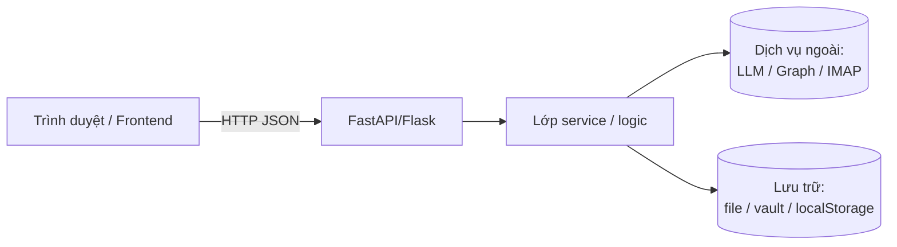
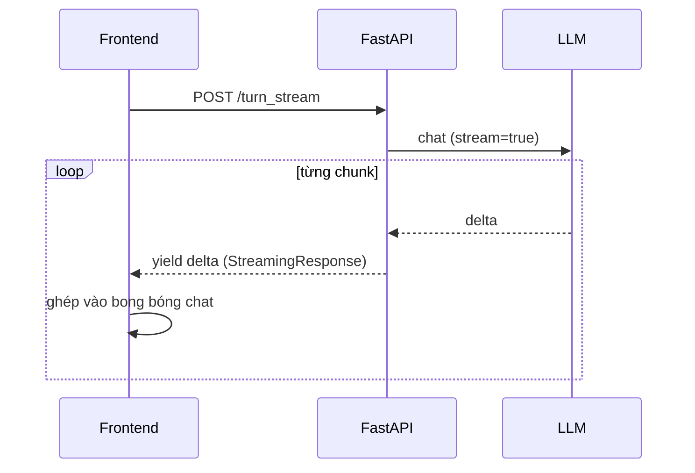
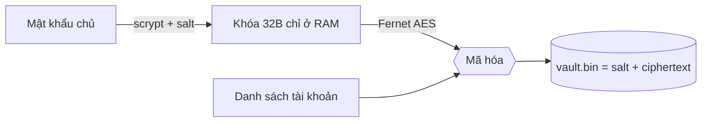
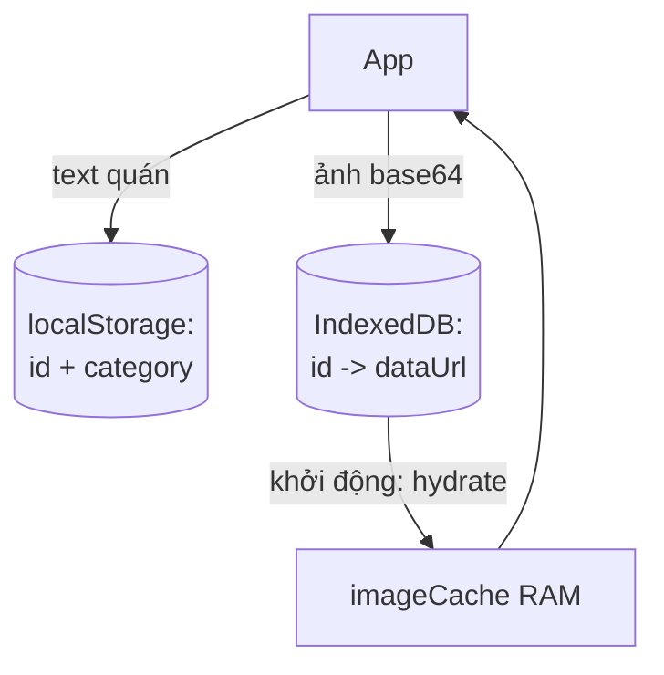
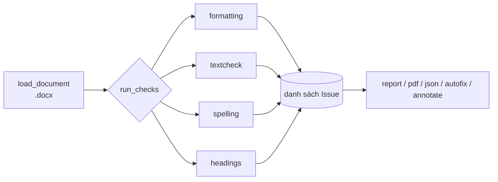
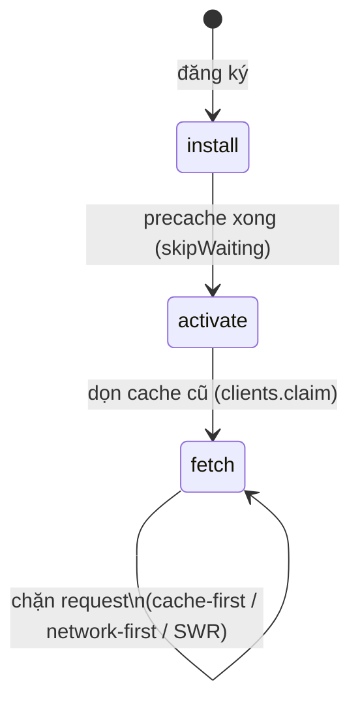
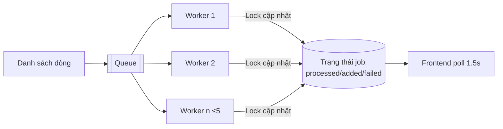

# 8. Sơ đồ Mermaid (vẽ nhanh khi giải thích)

Học thuộc vài sơ đồ này để **vẽ lại trên bảng/giấy** khi được hỏi "vẽ kiến trúc / luồng dữ liệu". Mermaid render được trên GitHub/nhiều editor.

## 1. Kiến trúc chung "client → API → service" (agent-talk / totp-manager / outlook)

## 2. Streaming từng chữ (agent-talk)

## 3. Mã hóa "không lưu khóa" (totp-manager)

## 4. Lưu trữ hai tầng (quan-quen-map)

## 5. Pipeline kiểm tra (word-checker)

## 6. Vòng đời Service Worker (PWA — cap-cuu-101 / quan-quen-map)

## 7. Job import đa luồng có hủy (outlook-mail-reader)

## Mẹo dùng
- Khi phỏng vấn online, có thể gõ Mermaid vào một editor chia sẻ màn hình.
- Khi offline (giấy/bảng): nhớ **hình khối + mũi tên hướng dữ liệu**, không cần cú pháp.
- Cú pháp tối thiểu cần nhớ: `flowchart LR/TB`, `A --> B`, `A -->|nhãn| B`, `[hộp]`, `[(trụ = lưu trữ)]`, `{quyết định}`.
- `sequenceDiagram` cho luồng theo thời gian; `stateDiagram-v2` cho vòng đời/trạng thái.

> 💡 Vẽ được sơ đồ kiến trúc dự án của bạn **từ trí nhớ** là một điểm cộng lớn — nó chứng tỏ bạn thực sự hiểu hệ thống mình xây.
