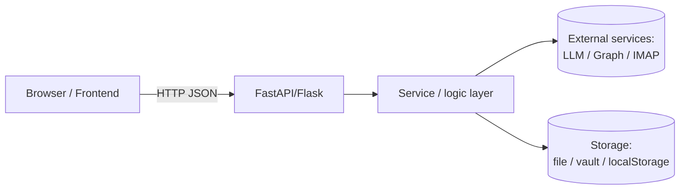
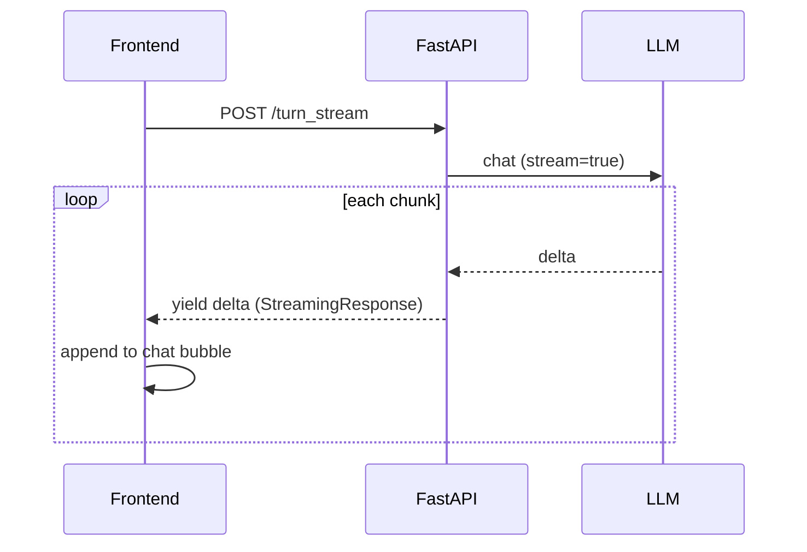
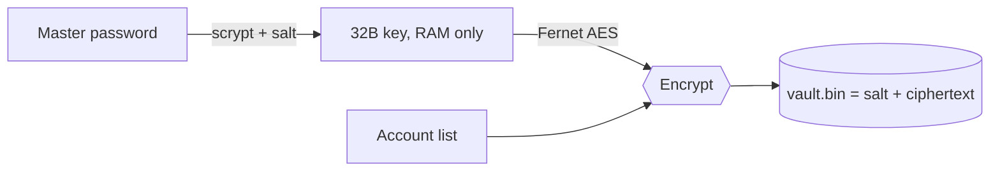
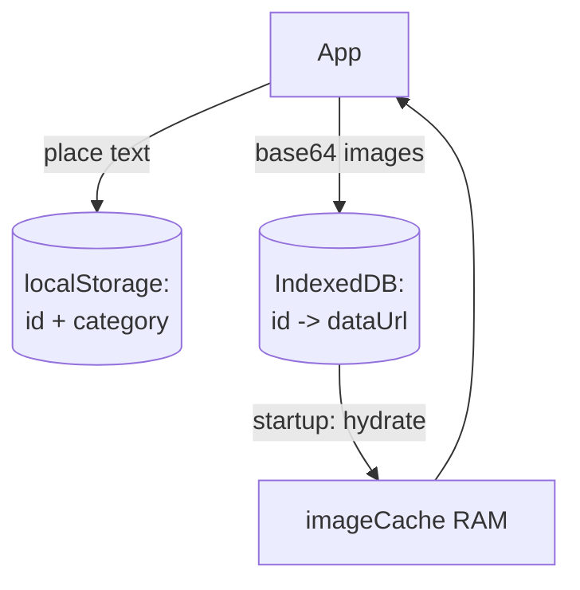
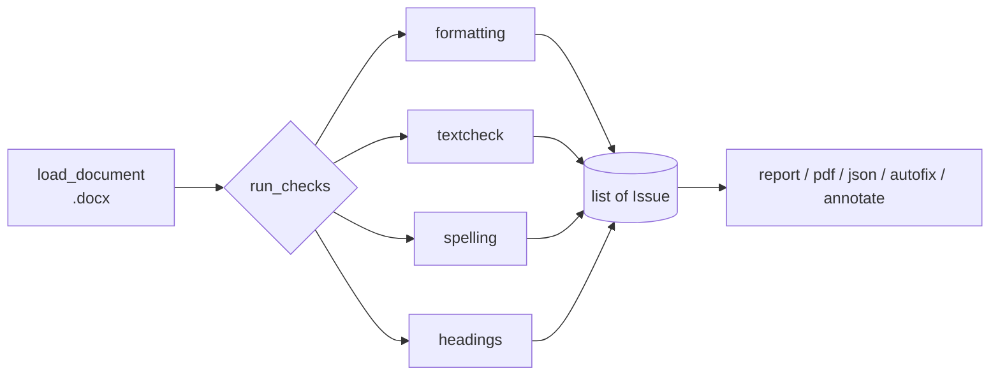
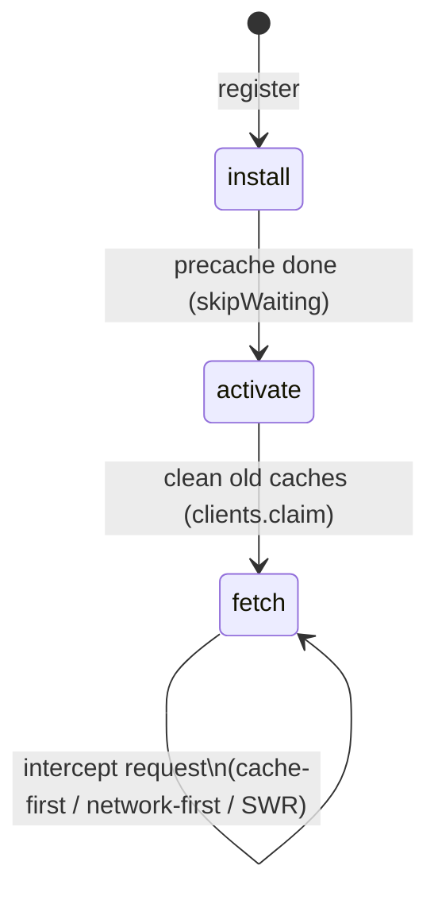
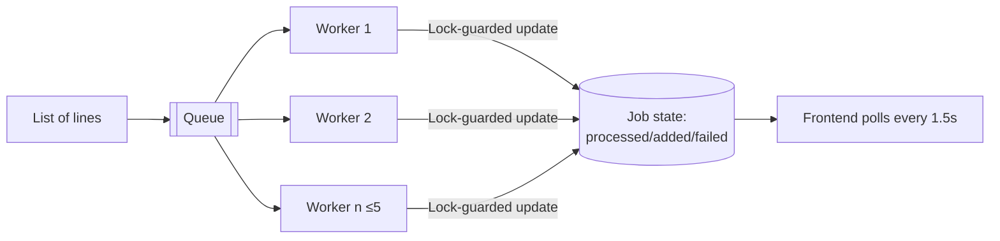

# 8. Mermaid Diagrams (draw quickly when explaining)

Memorize a few of these so you can **redraw them on a whiteboard/paper** when asked "draw the architecture / data flow". Mermaid renders on GitHub and many editors.

## 1. Generic "client → API → service" (agent-talk / totp-manager / outlook)

## 2. Token-by-token streaming (agent-talk)

## 3. "No stored key" encryption (totp-manager)

## 4. Two-tier storage (quan-quen-map)

## 5. Check pipeline (word-checker)

## 6. Service Worker lifecycle (PWA — cap-cuu-101 / quan-quen-map)

## 7. Cancelable multi-threaded import job (outlook-mail-reader)

## Usage tips
- In a remote interview, you can type Mermaid into a shared editor.
- Offline (paper/whiteboard): remember **boxes + arrows for data flow**, syntax not needed.
- Minimal syntax to remember: `flowchart LR/TB`, `A --> B`, `A -->|label| B`, `[box]`, `[(cylinder = storage)]`, `{decision}`.
- `sequenceDiagram` for time-ordered flows; `stateDiagram-v2` for lifecycles/states.

> 💡 Being able to draw your project's architecture **from memory** is a big plus — it proves you truly understand the system you built.
